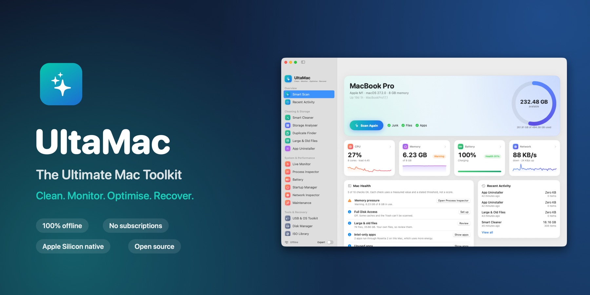
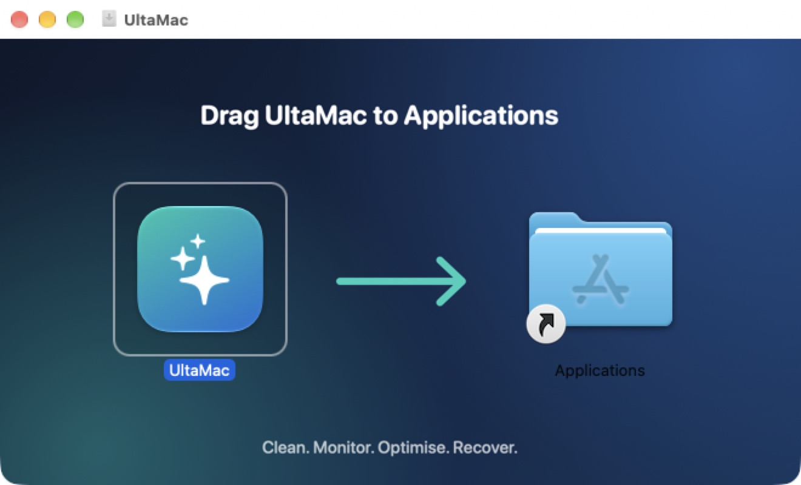
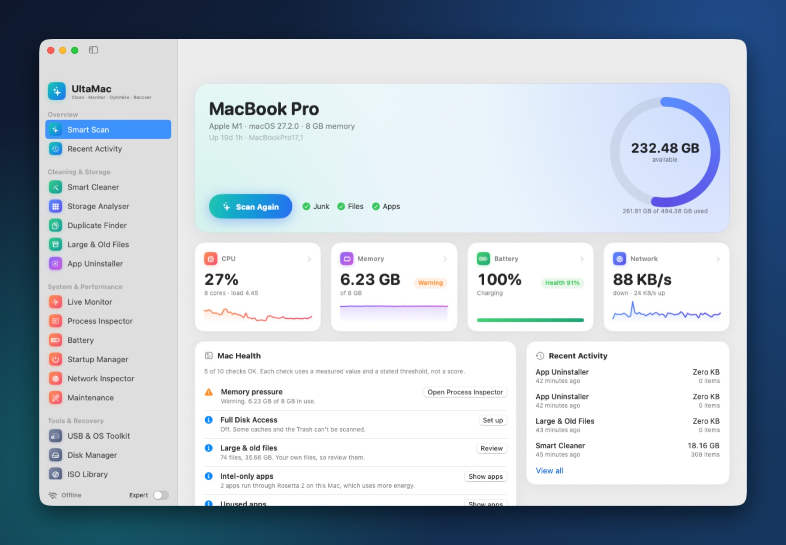
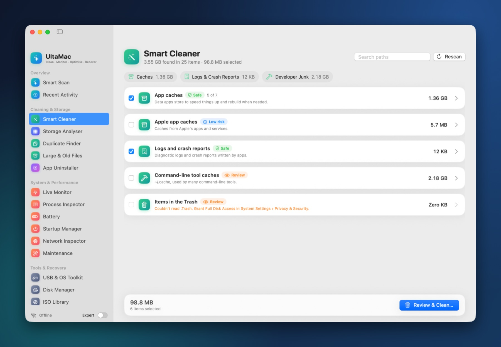
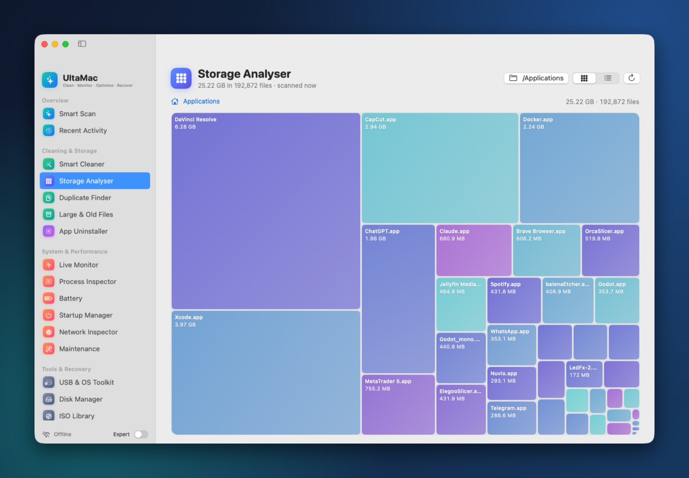
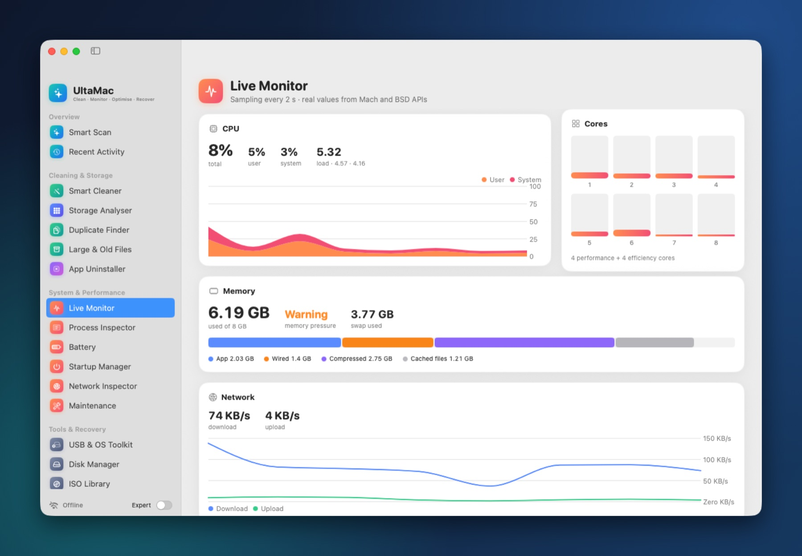
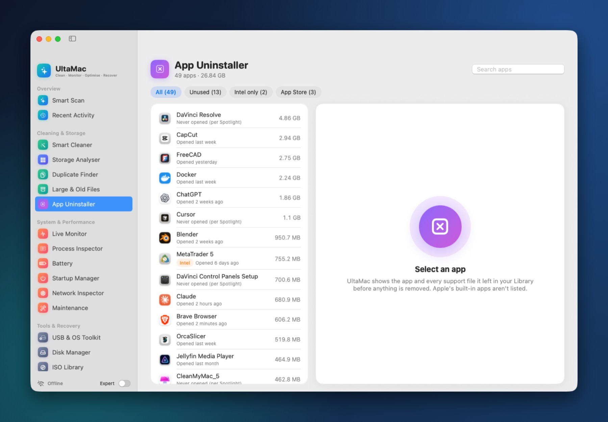
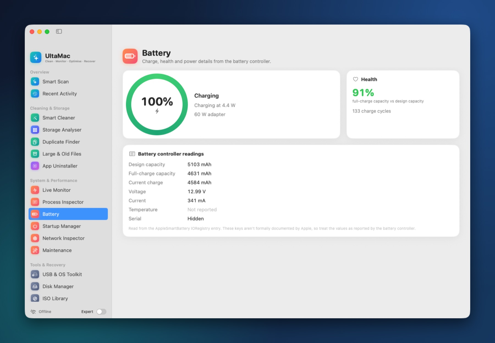
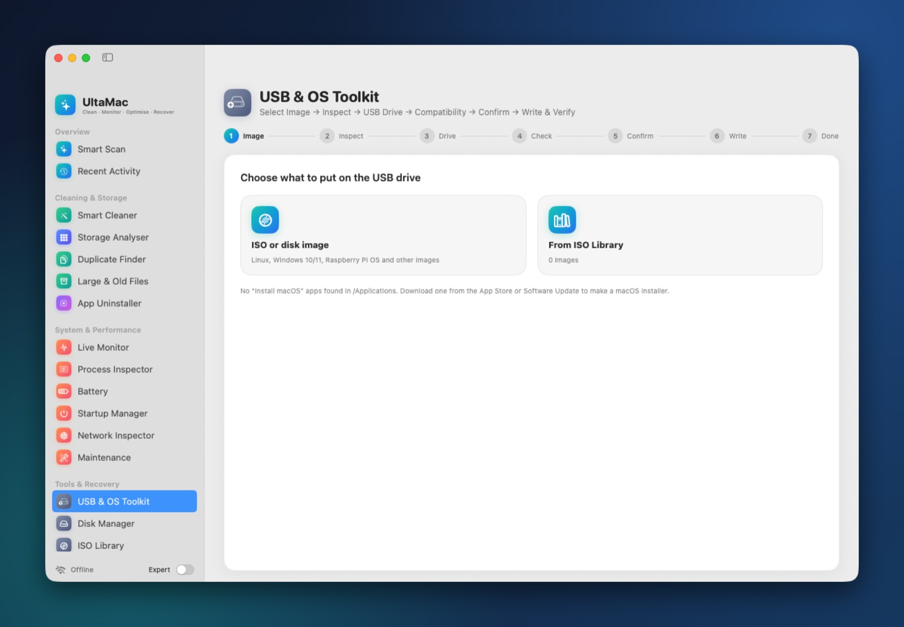
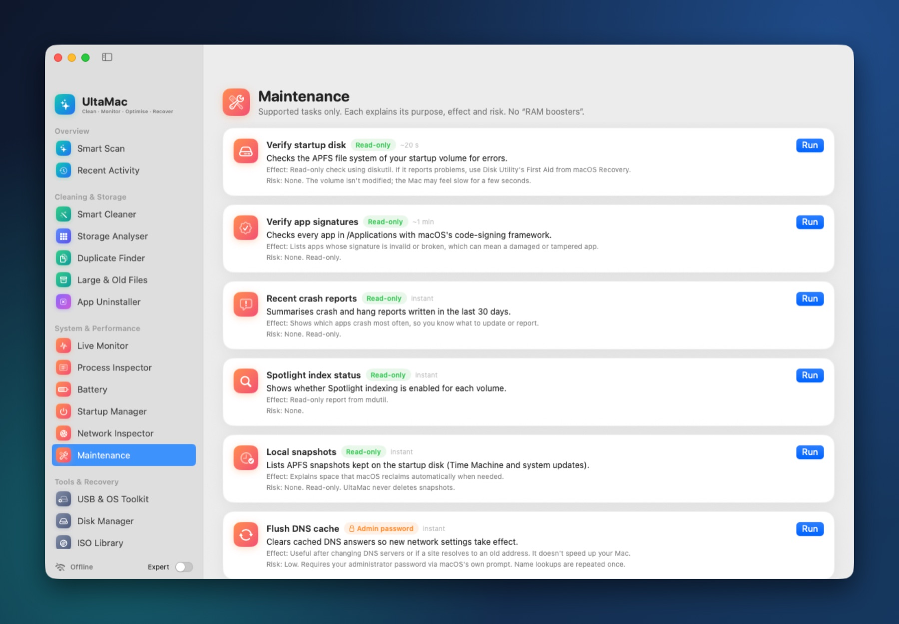

<p align="center">
  
</p>

<p align="center">
  <a href="https://github.com/ray0189/UltaMac/releases/latest"></a>
  
  
  <a href="LICENSE"></a>
  
</p>

<h3 align="center">Clean. Monitor. Optimise. Recover.</h3>
<p align="center">A native, fully offline Mac utility suite: cleaner, storage map, system monitor, uninstaller,<br>diagnostics and bootable-USB maker in one app. No accounts. No subscriptions. No telemetry.</p>

<p align="center">
  <a href="https://github.com/ray0189/UltaMac/releases/latest"><b>⬇︎ Download UltaMac.dmg</b></a> ·
  <a href="#features">Features</a> ·
  <a href="#safety">Safety</a> ·
  <a href="#build-from-source">Build</a> ·
  <a href="CONTRIBUTING.md">Contribute</a>
</p>

---

## Install



1. Download **UltaMac.dmg** from the [latest release](https://github.com/ray0189/UltaMac/releases/latest).
2. Open it and drag **UltaMac** onto **Applications**.
3. First launch: **right-click UltaMac → Open → Open**. It's free and not notarised by Apple, so macOS asks once. On macOS 15+, use **System Settings › Privacy & Security › Open Anyway**.
4. Optional: open **Permissions** in UltaMac and turn on Full Disk Access for complete scans.

Requires **macOS 14 Sonoma** or later · Universal (Apple Silicon + Intel).

<br clear="right">

---

## Features

### Smart Scan: your Mac at a glance
One read-only scan finds junk, large and forgotten files, unused apps and Intel-only apps. Health checks use measured values against stated thresholds; there's no made-up "health score".



### Smart Cleaner
Fourteen transparent rules (app caches, logs, Xcode DerivedData, simulator caches, npm/Gradle/Cargo, old installers, Trash), each labelled with its **risk** and **what happens if you remove it**. Caches of running apps are skipped automatically. Everything goes to the Trash first.



### Storage Analyser
An interactive treemap of any folder. Click to select, double-click to drill in, and switch to list view for details.



<table>
<tr>
<td width="50%"><b>Live Monitor</b><br>CPU (performance + efficiency cores), memory pressure, swap and network: real values from Mach and BSD APIs.<br><br></td>
<td width="50%"><b>App Uninstaller</b><br>Removes apps and the files they leave behind. Flags Intel-only apps that run through Rosetta and apps you haven't opened in months.<br><br></td>
</tr>
<tr>
<td><b>Battery</b><br>Health against design capacity, cycle count, live charge rate and adapter details.<br><br></td>
<td><b>USB & OS Toolkit</b><br>Guided bootable-USB wizard for Linux, Raspberry Pi OS, macOS and Windows, with write and SHA-256 verification and strict protection for internal disks.<br><br></td>
</tr>
</table>

### And also
| | |
|---|---|
| **Menu-bar panel** | Live CPU, memory, disk and battery, one-click **Quick Clean** of safe junk, and shortcuts to every tool |
| **Duplicate Finder** | Byte-identical files matched by size, then quick hash, then full SHA-256; always keeps one copy |
| **Large & Old Files** | Files over 100 MB or untouched for a year, filtered by kind |
| **Process Inspector** | Sort your processes by CPU or memory; quit apps |
| **Startup Manager** | Every launch agent and daemon, and when it starts |
| **Network Inspector** | Interfaces, IPs, DNS, router and open connections, read locally |
| **Maintenance** | Verify the disk, check app signatures, crash summary, Spotlight status, snapshots, DNS flush |
| **Disk Manager · ISO Library** | Inspect, eject and erase USB drives; organise images and verify checksums |
| **System Reports** | Export a hardware and software summary as Markdown or JSON |
| **Sounds & Expert Mode** | Original synthesised sound effects (on by default, adjustable in Settings); Expert Mode reveals paths, hashes and raw values |



---

## Safety
- **Read-only until you decide.** Every removal goes through a review sheet. The Trash is the default; permanent deletion asks twice.
- **Protected by design.** System folders, SIP-protected and locked files, keychains, Mail, Messages, iCloud Drive and Photos libraries are never touched, and nothing is ever unlocked or forced.
- **Disk tools you can trust.** The boot disk and internal drives are refused. A target is never auto-selected, erasing needs a typed confirmation, and the drive is re-checked right before writing.
- **Logged locally.** Every removal and disk operation is recorded on your Mac, and only there.
- **Offline.** No networking code, analytics, accounts or update checks.

More detail: [Security model](docs/Security-Model.md) · [Known limitations](docs/Known-Limitations.md) · [Test results](docs/Test-Results.md)

> **Early release.** USB writing is verified on disk images, not yet on physical drives, so use a spare stick. See [Feature matrix](docs/Feature-Matrix.md) for what's fully tested.

---

## Build from source
Requires macOS 14+ and Xcode 16+ (Swift 6).

```bash
git clone https://github.com/ray0189/UltaMac.git && cd UltaMac
swift test                          # 57 tests
scripts/build-app.sh --install      # build and install to /Applications
scripts/build-app.sh --release && scripts/make-dmg.sh   # universal build + DMG
```

Or open `Package.swift` in Xcode.

## Contributing
UltaMac is open source under the [MIT licence](LICENSE): use it, change it, share it. Fork the repo and open a pull request; see [CONTRIBUTING.md](CONTRIBUTING.md).

<sub>All code, the icon, the artwork and the sound effects are original. No third-party dependencies.</sub>
